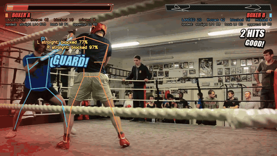

# Boxing punch analysis from ordinary video

**Who threw it, what punch it was, and whether it landed** — from a single camera, with a referee and a crowd in view.



<sub>Demo footage: *My first boxing sparring* by Michal Hradiš (YouTube, CC BY). Every effect is driven by a real output: health drops only on punches judged LANDED, GUARD! / WHIFF! show blocked / missed verdicts, trail colours show the punch family.</sub>

🧭 **How it works (4 pages):** [docs/Pipeline_Overview.pdf](docs/Pipeline_Overview.pdf)  
📄 **Full write-up:** [docs/Boxing_Punch_Analysis_Report.pdf](docs/Boxing_Punch_Analysis_Report.pdf) (13 pages: every phase, what failed, and how it was fixed)
📓 **Lab notebook:** [docs/research_log.md](docs/research_log.md) (every experiment, prediction and result, in order)

---

## Results

All numbers are on footage the model never trained on (unseen video, unseen gym, or the authors' held-out test set).

| Task | Data | Result |
|---|---|---|
| Punch type (6 classes) | BoxingVI, leave-one-video-out | **75.2%** balanced accuracy (goal: 60%) |
| Punch detection on real bouts | 29 Olympic bouts, 4,605 referee-labelled punches | found **79.4%** (old pipeline 24.8%), F1 **0.75** (was 0.33) |
| Punch detection | BoxingWeb test set | F1 **0.77–0.79** vs 0.78 published by BoxMind (loose matching) |
| Telling the two boxers apart | BoxingWeb test, whole rounds | **99.5–99.8%** of frames (motion tracking alone: 84%) |
| Landed / blocked / missed | Olympic, unseen gym, referee's contact moment | **74–76%** (always "landed": 62%) |
| Landed punches per bout | Olympic, full automatic chain | within **7.6%** of the referee (median) |

## How it works

```
video ─► RTMPose ─► boxer selector ─► identity (re-ID) ─► punch TCN ─► contact scan ─► per-boxer counts
         all people   picks the 2       A stays A,         when, which    VideoMAE-L:      thrown, landed /
                      fighters          through overlaps   hand, type     contact moment   blocked / missed,
                                                                          + verdict        by type
```

* **Pose:** YOLOX + RTMPose-m (rtmlib). MediaPipe saw both boxers at only 15% of real-bout punches; RTMPose sees them at 96%.
* **Boxer selector:** gradient-boosted trees on 65 skeleton-only features, trained on BoxingWeb's per-frame boxer poses (`boxingweb/train_selector.py`).
* **Identity:** OSNet-AIN person re-identification + a per-video A-vs-B classifier that keeps learning from its own answers (`boxingweb/identity_sparring.py`).
* **Punch detector:** dilated temporal CNN over both boxers' skeletons, per-frame no-punch / 6 classes (`boxingweb/punch_tcn.py`); type fused with a fine-tuned video model.
* **Landed:** VideoMAE-Large fine-tuned on referee contact clips with a 4th "off-centre" answer, scanned over 7 time offsets per punch (`hpc_rtm/contact_landed_finetune.py`).
* **Bag / BOB route:** OWLv2 finds the target, a no-opponent detector counts punches, contact = glove reaches the target outline (`bagroute/`).
* **Renderer:** fighting-game HUD where every effect reflects a measured output (`pipeline/arcade_fx.py`).

Run the whole chain on a video (after extracting RTMPose skeletons to `external/pose_rtm/` and placing the video in `external/raw/`):

```bash
python pipeline/count_video.py MY_CLIP            # sparring / bout: counts + rendered video
python pipeline/count_video.py MY_CLIP --bob      # one boxer on a BOB dummy or bag
python pipeline/count_video.py MY_CLIP --no-cards # without intro / results cards
```

## The journey, briefly

1. **Punch type from skeletons** (BoxingVI): 46% → 75% by fixing the data, not the model — a southpaw video read as mirrored, side-on jabs that look like hooks in 2D (fixed with real 3D), outlier joints (confidence filling).
2. **Detection:** the "no punch" gaps hid ~15% real punches; two independent detectors plus a blind human review with control punches built a clean no-punch class.
3. **The sparring wall:** a model trained on one boxer alone counted guard movement as punches (about half its sparring counts were fake). Speed augmentation, gating and fresh pose detection didn't fix it; an AI judge (Qwen3-VL, made 65× faster) measured it.
4. **Real bouts:** switched pose model, learned which people are the boxers, and solved identity with re-identification instead of tracking.
5. **Did it land?** Physics on the arm and 19 skeleton cues failed; a fine-tuned video model worked. Inside the full chain it first collapsed — traced to contact timing and to a misread label (the referee's box marks the *target*, not the puncher).

Details, numbers and dead ends: see the [report](docs/Boxing_Punch_Analysis_Report.pdf).

## Repository layout

| Folder | Contents |
|---|---|
| `pipeline/` | end-to-end runner and renderer |
| `boxingweb/` | selector, identity, punch TCN, type, evaluation on BoxingWeb |
| `olympic/` | Olympic dataset parsing, contact model, landed model scoring, full-chain scoring |
| `bagroute/` | bag / BOB route |
| `hpc_rtm/` | GPU jobs: RTMPose extraction, clip cutting, VideoMAE fine-tuning |
| `external/` | sparring test tooling: tracker, stance, VLM labeller |
| `detect/`, `videodet/`, `video3d/`, `lift3d/`, top-level `*.py` | phase 1–2: BoxingVI classifier, detectors, 3D |
| `docs/` | report, research log, figures, report generator |

## Data and licences

No dataset footage, labels or trained weights are included; get the data from its authors:

* **BoxingVI** — Kumar et al., arXiv 2511.16524.
* **Olympic Boxing Punch Classification Video Dataset** — Stefański, Kozak, Jach, *Entropy* 26(8):617, 2024 (Kaggle; non-commercial).
* **BoxingWeb / BoxMind** — Wang et al., arXiv 2601.11492.

Models: RTMPose / YOLOX (rtmlib), MediaPipe, VideoPose3D, VideoMAE (CC-BY-NC-4.0), OSNet / OSNet-AIN (MIT, `third_party/osnet/`), Qwen3-VL (Apache-2.0), OWLv2. Because VideoMAE and the Olympic data are non-commercial, the landed model built from them is for research and personal use only.

## Status

Built in four days (Nov 12–15, 2026) as a personal research and learning project on a MacBook and a university GPU cluster. Sparring accuracy is **not measured** (no labels exist for the sparring clips); all accuracy figures come from labelled real bouts.
